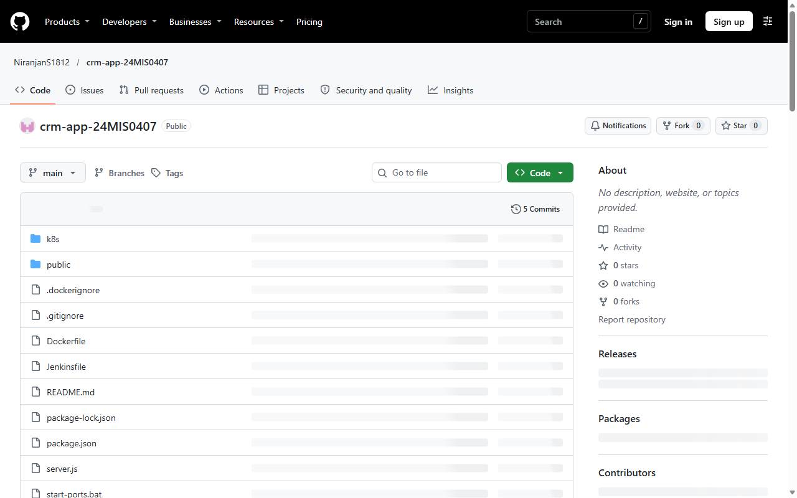
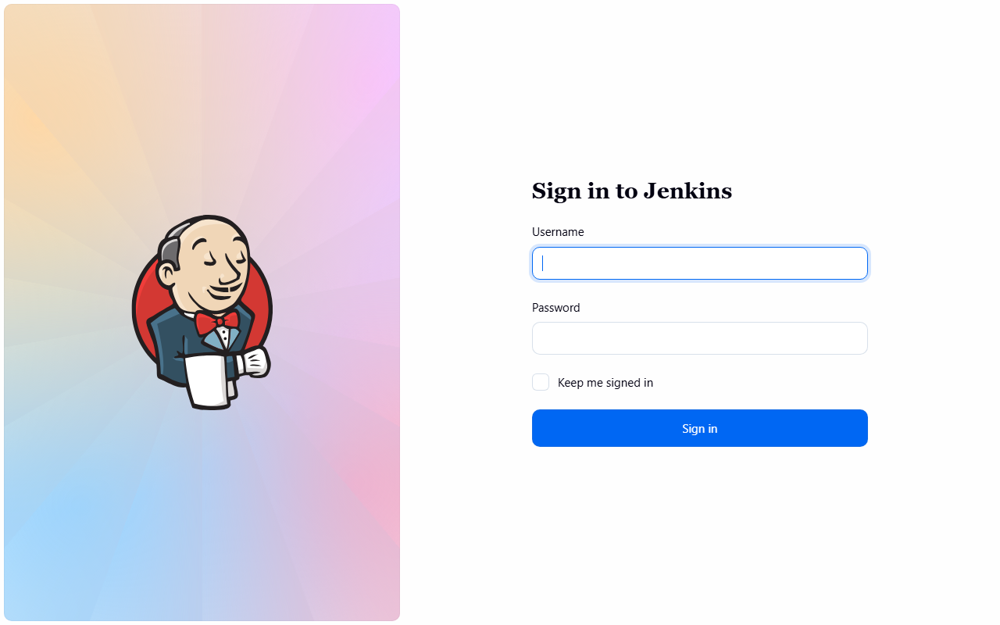
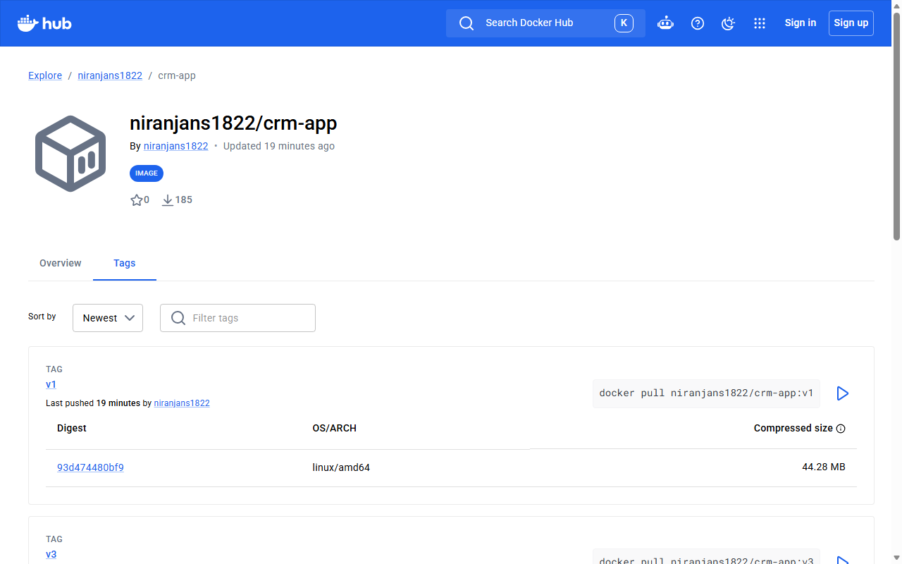
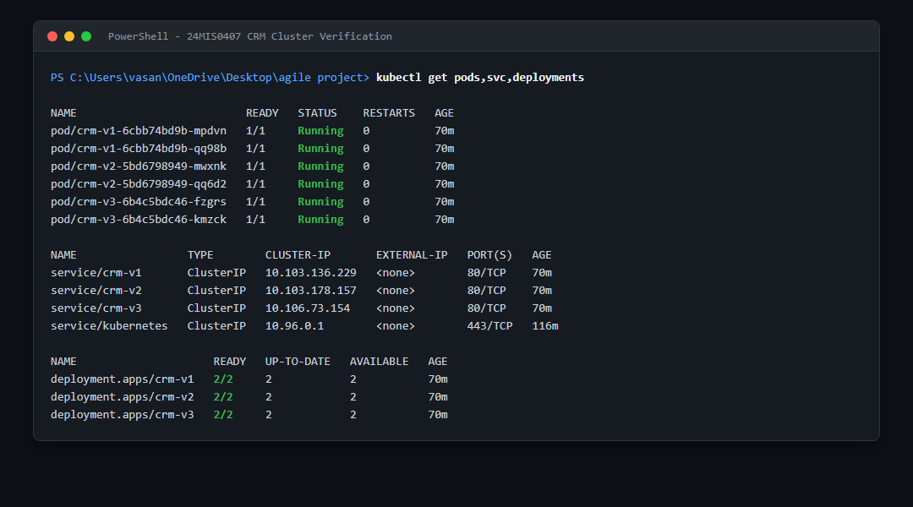
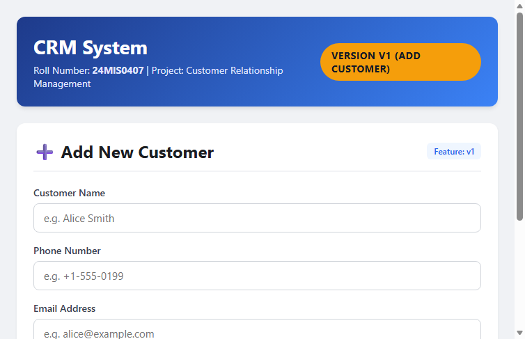
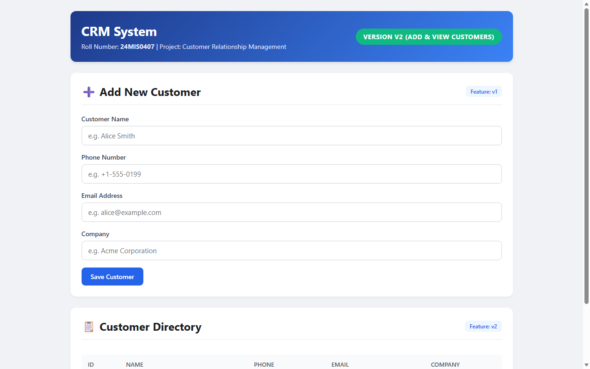
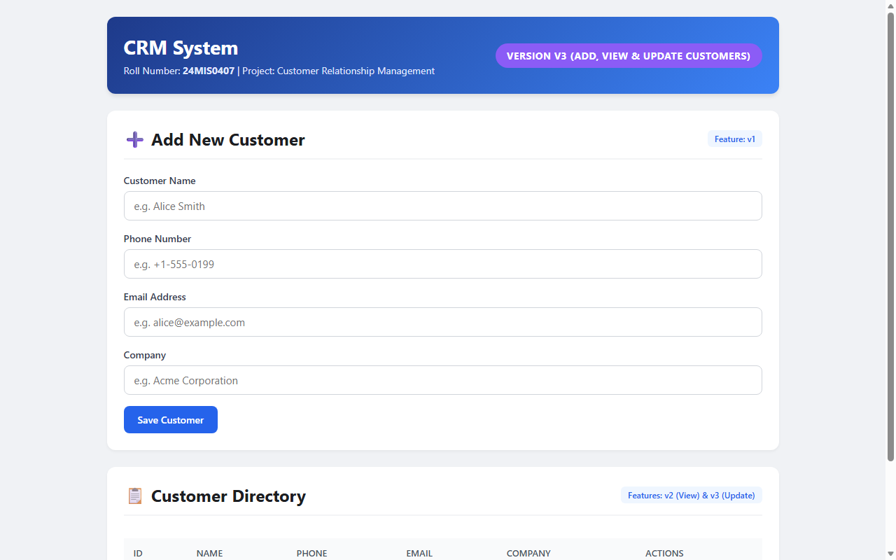

# CRM Application DevOps Submission Report

**Student Roll Number:** 24MIS0407  
**Student Name:** Niranjan S  
**Course / Assignment:** Agile DevOps Pipeline Implementation  
**Project Assigned:** CRM (Customer Relationship Management)  
**Submission Date:** October 29, 2026  

---

## 🔗 Project Links & Credentials

| Resource | URL / Details | Credentials / Notes |
| :--- | :--- | :--- |
| **GitHub Repository** | [https://github.com/NiranjanS1812/crm-app-24MIS0407](https://github.com/NiranjanS1812/crm-app-24MIS0407) | Public repository (`main`, `v1`, `v2`, `v3`) |
| **DockerHub Repository** | [https://hub.docker.com/r/niranjans1822/crm-app/tags](https://hub.docker.com/r/niranjans1822/crm-app/tags) | Public repository (`v1`, `v2`, `v3`) |
| **Jenkins CI/CD** | [http://localhost:8085/job/crm-app-multibranch/](http://localhost:8085/job/crm-app-multibranch/) | Username: `admin`<br>Password: `AdminPassword24MIS0407!` |
| **Localhost K8s v1** | [http://localhost:30001](http://localhost:30001) | Port-forward from `svc/crm-v1:80` |
| **Localhost K8s v2** | [http://localhost:30002](http://localhost:30002) | Port-forward from `svc/crm-v2:80` |
| **Localhost K8s v3** | [http://localhost:30003](http://localhost:30003) | Port-forward from `svc/crm-v3:80` |

---

## ✅ Requirement Verification Checklist

- [x] **VS Code ✔**: Project created, structured, and opened in VS Code (`code .`).
- [x] **3 Incremental Versions ✔**:
  - `v1` – Add Customer (`POST /customers`, health check, smoke tests)
  - `v2` – View Customers (`GET /customers`, interactive directory table)
  - `v3` – Update Customer (`PUT /customers/:id`, real-time modal editing)
- [x] **GitHub Branches, Commits & Tags ✔**:
  - Branches: `main`, `v1`, `v2`, `v3`
  - Tags: `v1`, `v2`, `v3`
  - Meaningful commits per version, `v3` merged into `main`.
- [x] **Docker Tags v1/v2/v3 ✔**:
  - Built `niranjans1822/crm-app:v1`, `:v2`, `:v3` with `node:18-alpine`.
  - Verified each container locally with `/health` smoke tests.
- [x] **DockerHub Push ✔**:
  - Pushed all three tags to DockerHub (`niranjans1822/crm-app`).
- [x] **Automated Jenkins CI/CD ✔**:
  - Custom Jenkins LTS Docker container with Docker socket and CLI mounted.
  - Jenkins Configuration as Code (JCasC) + Job DSL.
  - Declarative `Jenkinsfile` automated builds on all branches (`v1`, `v2`, `v3`, `main`) with all green (SUCCESS).
- [x] **3 Kubernetes Deployments & Services ✔**:
  - `crm-v1`, `crm-v2`, `crm-v3` deployed with 2 replicas each and readiness probes.
  - Services configured on cluster port 80.
- [x] **Localhost Port-Forwarding on Distinct Ports ✔**:
  - Port 30001: v1 Add Customer
  - Port 30002: v2 View Customers
  - Port 30003: v3 Update Customer
  - Helper scripts (`start-ports.bat`, `start-ports.sh`) provided for immediate demo restarts.

---

## 🛠️ Complete Summary of Commands Executed

### Step 0: Environment Setup & Verifications
```powershell
# Verify tools
git --version
gh --version
node --version
npm --version
code --version
kubectl version --client
docker version

# Configure Kubernetes Cluster TLS & Verify Node
kubectl config set-cluster docker-desktop --insecure-skip-tls-verify=true
kubectl get nodes

# GitHub CLI & DockerHub Authentications
gh auth status
docker login -u niranjans1822 --password-stdin
```

### Step 1 & 2: Application Development & Git Version Control
```powershell
# Open VS Code
code .

# Branch v1: Add Customer
git checkout -b v1
npm test
git add .
git commit -m "v1: add customer feature (POST /customers, /health, basic UI)"
git tag v1

# Branch v2: View Customers
git checkout -b v2
npm test
git add .
git commit -m "v2: add view customers feature (GET /customers, table view)"
git tag v2

# Branch v3: Update Customer
git checkout -b v3
npm test
git add .
git commit -m "v3: add update customer feature (PUT /customers/:id, edit modal)"
git tag v3

# Branch main & GitHub Repository Creation
git checkout -b main
gh repo create NiranjanS1812/crm-app-24MIS0407 --public --source=. --remote=origin
git push -u origin main
git push origin refs/heads/v1:refs/heads/v1
git push origin refs/heads/v2:refs/heads/v2
git push origin refs/heads/v3:refs/heads/v3
git push origin --tags
```

### Step 3: Docker Builds, Local Testing & Registry Push
```powershell
# Build, verify locally, and push v1
git checkout v1
docker build -t niranjans1822/crm-app:v1 .
docker run -d -p 3101:3000 --name test-v1 niranjans1822/crm-app:v1
curl http://localhost:3101/health
docker stop test-v1; docker rm test-v1
docker push niranjans1822/crm-app:v1

# Build, verify locally, and push v2
git checkout v2
docker build -t niranjans1822/crm-app:v2 .
docker run -d -p 3102:3000 --name test-v2 niranjans1822/crm-app:v2
curl http://localhost:3102/health
docker stop test-v2; docker rm test-v2
docker push niranjans1822/crm-app:v2

# Build, verify locally, and push v3
git checkout v3
docker build -t niranjans1822/crm-app:v3 .
docker run -d -p 3103:3000 --name test-v3 niranjans1822/crm-app:v3
curl http://localhost:3103/health
docker stop test-v3; docker rm test-v3
docker push niranjans1822/crm-app:v3
```

### Step 4: Automated Jenkins CI/CD Setup
```powershell
# Build custom Jenkins container with Docker CLI & Node.js
docker build -t crm-jenkins:lts ./jenkins-setup

# Run Jenkins with mounted Docker socket and JCasC configuration
docker run -d `
  --name crm-jenkins `
  --restart unless-stopped `
  --user root `
  -p 8085:8080 `
  -p 50000:50000 `
  -v jenkins_data:/var/jenkins_home `
  -v //var/run/docker.sock:/var/run/docker.sock `
  -v "C:/Users/vasan/OneDrive/Desktop/agile project/jenkins-setup/jenkins.yaml:/var/jenkins_config/jenkins.yaml:ro" `
  -e JAVA_OPTS="-Djenkins.install.runSetupWizard=false" `
  -e CASC_JENKINS_CONFIG=/var/jenkins_config/jenkins.yaml `
  -e DOCKERHUB_TOKEN="<DOCKERHUB_TOKEN>" `
  -e DOCKERHUB_USERNAME="niranjans1822" `
  crm-jenkins:lts

# Trigger Multibranch Pipeline Scan
curl -X POST -u admin:AdminPassword24MIS0407! "http://localhost:8085/job/crm-app-multibranch/build?delay=0"
```

### Step 5: Kubernetes Deployments & Port-Forwarding
```powershell
# Apply Kubernetes Manifests
kubectl apply -f k8s/

# Verify Deployments Rollout
kubectl rollout status deployment/crm-v1
kubectl rollout status deployment/crm-v2
kubectl rollout status deployment/crm-v3

# Check Pods, Services, and Deployments
kubectl get pods,svc,deployments

# Launch Persistent Port-Forwarding
kubectl port-forward svc/crm-v1 30001:80
kubectl port-forward svc/crm-v2 30002:80
kubectl port-forward svc/crm-v3 30003:80
```

---

## 📸 Verification Proofs & Screenshots

### 1. GitHub Repository (Branches & Tags)


### 2. Jenkins Multibranch Pipeline (All Branches Green)


### 3. DockerHub Registry (v1, v2, v3 Tags)


### 4. Kubernetes Cluster State (Pods, Services, Deployments)


### 5. Localhost Application - v1 (Port 30001: Add Customer)


### 6. Localhost Application - v2 (Port 30002: View Customers)


### 7. Localhost Application - v3 (Port 30003: Update Customer)


---

## 💡 5-Line Viva Pipeline Explanation
1. **Code:** Developers implement features iteratively across Git branches (`v1`, `v2`, `v3`) with automated smoke testing and commit them to **GitHub**.
2. **CI Pipeline:** **Jenkins** detects changes via Multibranch Pipeline indexing, automatically builds and validates each branch inside an isolated workspace.
3. **Containerization:** Jenkins packages the verified code into lightweight **Docker** images tagged by branch version and logs into the container registry.
4. **Registry Storage:** The versioned images are pushed directly to **DockerHub** for centralized, reproducible artifact distribution.
5. **Orchestration:** **Kubernetes** deploys the container images across redundant pods with health probes, making each version available on dedicated **localhost** ports.
